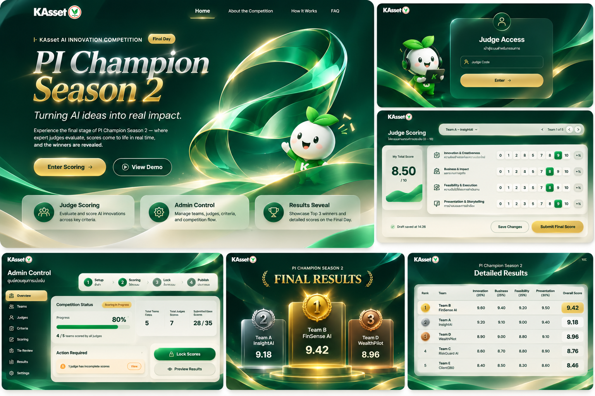
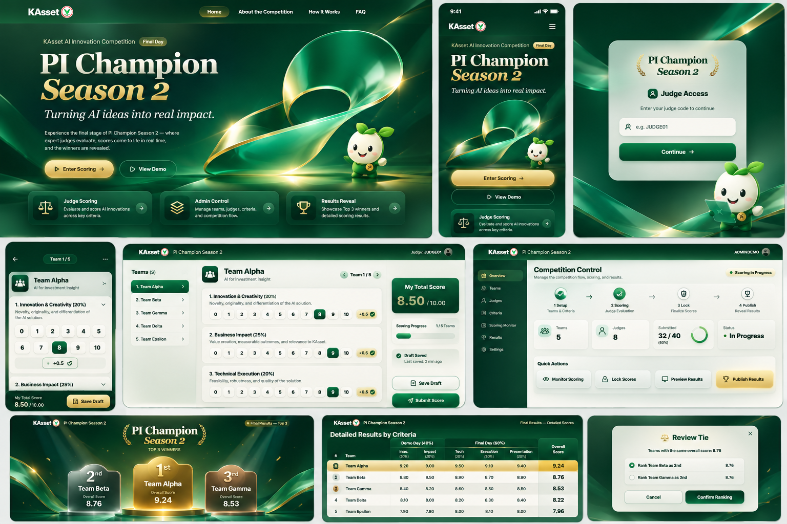
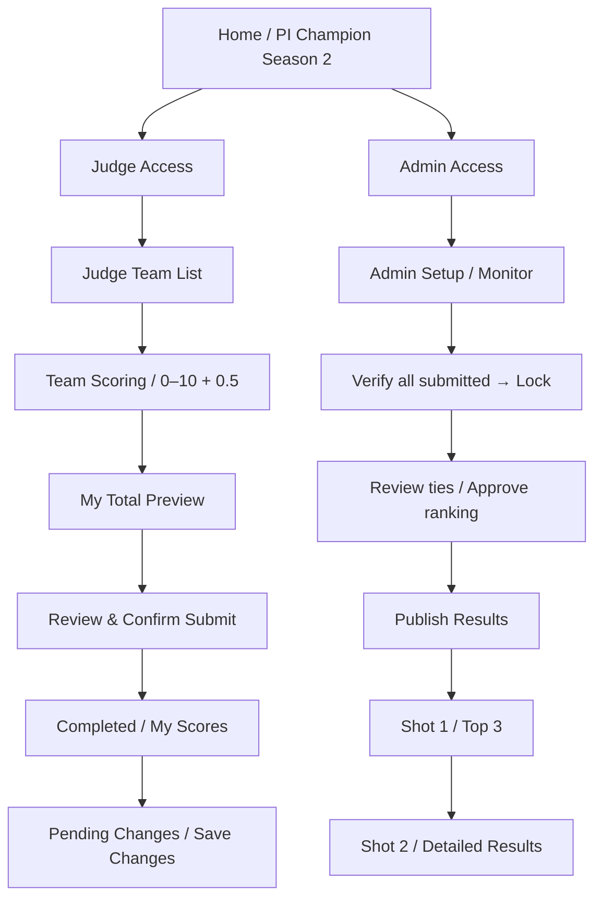

# PI Champion Season 2 — Live Judge Scoring Platform

**KAsset AI Innovation Competition · Interactive Website Prototype (Design Journey v4)**

> **สถานะ: UX / Frontend Demo — ยังไม่ใช่ระบบแข่งขันจริง**  
> โปรเจกต์นี้เป็นต้นแบบเพื่อให้ทีมงานและผู้มีส่วนเกี่ยวข้องทดลองการให้คะแนน การควบคุมการแข่งขัน และการประกาศผล ไม่ได้เชื่อมฐานข้อมูลหรือระบบยืนยันตัวตนที่ปลอดภัย จึง **ห้ามนำไปเก็บคะแนนกรรมการหรือข้อมูลพนักงานจริง** จนกว่าจะพัฒนา Backend และผ่านการทดสอบครบถ้วน

**ลองดูเดโม:** [pi-champion-s2-demo.vercel.app](https://pi-champion-s2-demo.vercel.app/) (ลิงก์เว็บทดลอง อาจมีการอัปเดตแยกจากไฟล์ใน ZIP)  
**Repository เป้าหมาย:** [Paopasatiht/CG-PI-Champion-SS2-Voting-Site](https://github.com/Paopasatiht/CG-PI-Champion-SS2-Voting-Site) (ยังไม่ได้ Push ผ่านการจัดชุดไฟล์นี้)

## ภาพรวมโปรเจกต์

**PI Champion Season 2** เป็นการแข่งขันภายใน KAsset ให้ทีมพนักงานนำ AI มาปรับปรุงงานจริง แล้วนำเสนอผลงานต่อคณะกรรมการ ระบบนี้ออกแบบมาเพื่อรองรับการให้คะแนน **เฉพาะกรรมการ (Judge Scoring)** และประกาศผลแบบควบคุมลำดับการเปิดเผย โดยไม่เปิดเผยคะแนนของกรรมการรายบุคคล

**เป้าหมายด้าน UX**

- กรรมการใช้มือถือ, iPad หรือ PC ให้คะแนนได้ง่าย มีสถานะ Draft / Submitted ชัดเจน
- ผู้จัดงานดูความครบถ้วนของการประเมินและควบคุม Lock / Publish ได้
- หน้า Results สำหรับฉายโปรเจกเตอร์ประกาศ **Top 3** ก่อน แล้วแสดงคะแนนเฉลี่ยรายเกณฑ์ครบทุกทีม
- ภาพลักษณ์ Emerald–Gold / Ivory ที่สอดคล้องกับแนวคิดนวัตกรรม AI (รายละเอียดแบรนด์เป็น **concept** จนกว่าจะมี Asset ทางการ)

### ภาพแนวทาง UI (AI-generated design concepts)





> รูปด้านบนคือ **ภาพแนวคิด** ไม่ใช่ Screenshot จากเว็บจริง ชื่อทีม คะแนน โลโก้ และมาสคอตในภาพเป็นข้อมูล/ภาพจำลอง; ใช้เป็น Art Direction เท่านั้น

## ฟีเจอร์ใน Demo นี้

| ส่วน | ทดลองได้แล้ว | หมายเหตุ |
| --- | --- | --- |
| **Home** | หน้าแนะนำการแข่งขันและทางเข้า Judge / Admin | Emerald Ribbon / Cinematic Styling |
| **Judge Access** | กรอกรหัสตัวอย่างเพื่อเข้าสู่ระบบ | เช็กใน JavaScript เท่านั้น ไม่ปลอดภัยสำหรับจริง |
| **Judge Dashboard** | รายชื่อ **12 ทีม** เรียงตามลำดับนำเสนอ, Filter สถานะ | Free Scoring: เลือกประเมินทีมใดก่อนก็ได้ |
| **Judge Scoring** | ให้คะแนนแต่ละเกณฑ์ด้วยปุ่ม **1–10**, มี `0` และ `+0.5` | ไม่มี Slider; คะแนนที่ยังไม่เลือกคือ Missing ไม่ใช่ 0 |
| **Draft / Confirm** | Draft แบบ browser-local, My Total Preview, Confirm Submit Modal | แสดง My Total เมื่อให้คะแนนครบทุกเกณฑ์ |
| **Edit after Submit** | กลับมาแก้คะแนนแล้วกด **Save Changes** | คะแนนที่ Confirm ล่าสุดยังเป็นตัวหลักจนกด Save Changes |
| **Admin Dashboard** | ดู Progress จำลอง, จัดการทีม/ลำดับ, Import/Edit Demo Scores, เปลี่ยนน้ำหนักรอบ | Admin Code เป็นรหัส Demo; ข้อมูลเก็บแค่ใน Browser |
| **Lock / Unlock / Publish** | จำลอง Lock รายทีม, Lock All, Unlock ก่อน Publish และ Publish | มีข้อมูลกรรมการจำลอง; **ยังไม่ใช่ Server-side Lock** |
| **Tie Review** | หน้าสาธิต UX ตรวจคะแนนเสมอ | ยังไม่ใช่กระบวนการอนุมัติ Tie-break จริง |
| **Results Reveal** | Shot 1: Top 3; Shot 2: ตารางคะแนนพร้อมค่าเฉลี่ยแต่ละเกณฑ์ | Public Results ถูกซ่อนก่อน Publish ตามสถานะ Demo |

## เส้นทางการใช้งาน (User Journey)



### รหัสทดลอง

| บทบาท | รหัส | ใช้เพื่อ |
| --- | --- | --- |
| Judge | `JUDGE01` | เข้า Team List และทดลองให้คะแนน |
| Admin | `ADMINDEMO` | เข้า Dashboard, จำลอง Lock และ Publish |

**รหัสเหล่านี้ปรากฏในซอร์สและเป็นเพียงค่าทดลอง ห้ามใช้กับระบบจริง**

### ทดลองเส้นทางกรรมการ

1. เปิดเว็บ แล้วเลือก **Enter Scoring** หรือเมนูกรรมการ
2. ใส่รหัส `JUDGE01` แล้วเข้า Dashboard
3. เลือกทีม เช่น `Team Aurora` (ลำดับนำเสนอที่ 03)
4. ให้คะแนนทุกเกณฑ์ด้วยปุ่ม 1–10; กด `+0.5` เมื่อต้องการคะแนนครึ่งแต้ม (มีปุ่ม `0` แยกต่างหาก)
5. เมื่อกรอกครบทุกเกณฑ์ ระบบจะแสดง **My Total** ของกรรมการคนนี้เป็น Preview
6. กด **Review & Submit** → ตรวจรายการใน Popup → **Confirm Submit**
7. กลับมาแก้ไขทีมเดิมได้ก่อน Lock; ถ้าแก้หลัง Submit ต้องกด **Save Changes** อีกครั้ง

### ทดลองเส้นทาง Admin และการประกาศผล

1. เข้า **Admin Access** ด้วย `ADMINDEMO`
2. ดูสถานะทีม, ตาราง Demo Scores และน้ำหนักรอบ (ค่าเริ่มต้น Demo 20% / Final Day 80%)
3. ใช้ **เติมคะแนนจำลองให้ครบ** เพื่อทดสอบขั้นตอน Admin โดยไม่ต้องลงคะแนนทุกทีมด้วยตนเอง
4. กด **Lock All** เมื่อสถานะครบทุกทีมใน Demo
5. ตรวจสอบ/จำลองเงื่อนไขการประกาศผล แล้วกด **Publish Results**
6. สลับหน้าจอ **Shot 1 — Top 3** และ **Shot 2 — Detailed Results** (รองรับการแสดงเต็มจอ)

> คำเตือน: การกด Submit, Lock หรือ Publish ใน Demo นี้มีผลเฉพาะข้อมูลทดสอบของเบราว์เซอร์เครื่องนั้น ไม่กระทบกรรมการ/ผู้ใช้อื่น

## หน้าเว็บและ URL (แยก Judge / Admin)

| หน้า | URL | ขั้นตอน |
|---|---|---|
| กรรมการ (หน้าแรก) | `/` หรือ `/index.html` | `#login` → `#teams` → `#team-<id>` |
| Admin | `/admin` หรือ `/admin.html` | `#login` → `#admin` → `#results` |

- หน้าแรกของเว็บคือหน้า **Judge Access** เสมอ
- แต่ละขั้นมี URL ของตัวเอง กด Refresh แล้วอยู่หน้าเดิม และปุ่ม Back ของเบราว์เซอร์ใช้ได้
- หน้าของกรรมการไม่มีปุ่มหรือลิงก์ไปหน้า Admin; Admin เข้าผ่าน `/admin` โดยตรงเท่านั้น
- ยังไม่ได้ Login แล้วเปิด URL ข้างใน ระบบจะพากลับไปหน้า `#login`
- กดโลโก้ KAsset: กรรมการไป Judge Dashboard, Admin ไป Admin Dashboard
- `demo-single-file.html` (Judge flow ไฟล์เดียว) สร้างจาก `python3 tools/build-single-file.py`

## กติกาคะแนนที่ใช้เป็น Design Target

- Final Day ให้คะแนน **0–10** ครั้งละ **0.5** ตามเกณฑ์ที่ Admin กำหนด
- ข้อมูล Demo Round เป็น **ค่าเฉลี่ยของแต่ละทีมในแต่ละเกณฑ์** ที่นำเข้าล่วงหน้า
- Demo และ Final Day ใช้ชุดเกณฑ์และน้ำหนัก **แยกกัน**
- หาค่าเฉลี่ยคะแนนกรรมการ **ภายในแต่ละเกณฑ์** แล้วคูณน้ำหนักก่อนนำทุกเกณฑ์มาบวกกัน; ไม่เฉลี่ยข้ามเกณฑ์อีกรอบ
- Overall Score รวม Demo / Final Day โดย **Default 20% / 80%** และต้องปรับได้
- คำนวณระหว่างทางด้วยความละเอียดเต็ม แล้ว **ปัด Overall Score เป็น 2 ตำแหน่งก่อนจัดอันดับ**
- คะแนนเสมอที่กระทบ Top 3 ต้องผ่านการตรวจทานและ Admin ตัดสินอันดับสุดท้าย (บันทึกเหตุผล โดยไม่แก้คะแนนคำนวณ); ตั้งแต่อันดับ 4 สามารถมีอันดับร่วมได้
- แสดงผลต่อสาธารณะ **หลังปิดโหวตและ Publish เท่านั้น**; ไม่แสดงคะแนนรายกรรมการ

สูตรเชิงแนวคิด:

```text
Final criterion average  = sum(confirmed score of eligible judges) / eligible judge count
Final Day score (0–100)  = Σ (criterion average × criterion weight / 10)
Demo Round score (0–100) = Σ (pre-aggregated criterion average × Demo criterion weight / 10)
Overall score            = 0.20 × Demo Round score + 0.80 × Final Day score
Displayed ranking score  = round(Overall score to 2 decimal places)
```

ในสูตรตัวอย่าง `criterion weight` เป็นตัวเลขเปอร์เซ็นต์ เช่น 30 หมายถึง 30%; การหารด้วย **10** จึงแปลงคะแนนดิบ 0–10 ให้เป็นคะแนนถ่วงน้ำหนักบนสเกล **0–100** (เช่น 8.5 × 30 / 10 = 25.5 คะแนน) ซึ่งตรงกับสูตรในต้นแบบปัจจุบัน ต้องทดสอบค่าเฉลี่ยและการปัดเศษกับ `spec.md` อีกครั้งก่อนใช้จริง

**ข้อเท็จจริงของ Demo:** ระบบใช้ข้อมูลคะแนนกรรมการจำลอง **14 คน + 1 ผู้ใช้ทดลอง** เพื่อสาธิต Average และ Progress; ไม่มีกรรมการ 15 คนที่เชื่อมกันจริง

## Tech Stack

| ชั้น | เทคโนโลยี |
| --- | --- |
| UI | HTML5, CSS3 (responsive layouts), Vanilla JavaScript |
| Animation / Graphic | CSS/SVG, decorative WebGL ribbon, embedded image-based hero artwork |
| State (Prototype) | `localStorage` ของเบราว์เซอร์ |
| Build Tool | ไม่มี — เป็น Static Website |
| Hosting | รองรับ Vercel / Static Hosting ทั่วไป |
| Tests | Node.js smoke tests สำหรับตรวจไฟล์และ Syntax |

**ไม่มี Backend, Database, WebSocket, OAuth/SSO, การเข้ารหัสข้อมูลกรรมการ หรือระบบ Auth จริง**

## วิธีเปิดใช้งานบนเครื่อง

สิ่งที่ต้องมี: **Python 3** (สำหรับเปิดเว็บแบบ Local) หรือ Static File Server ใด ๆ

```bash
# แตก ZIP แล้วเข้าโฟลเดอร์ที่มี index.html
python -m http.server 8080
```

เปิดเบราว์เซอร์ที่ <http://localhost:8080>

ทางเลือก: เปิดไฟล์ `demo-single-file.html` ได้โดยตรงสำหรับทดลองแบบไฟล์เดียว หากมีปัญหาการทำงานของเบราว์เซอร์กับ `file://` ให้ใช้ Local Server ตามวิธีด้านบน

### ทดสอบไฟล์

ถ้ามี Node.js 18+:

```bash
node --check assets/js/app.js
node --check assets/js/ribbon3d.js
node tests/smoke.mjs
# หรือ npm test (มี package.json สำหรับเรียก smoke test)
```

## โครงสร้างโปรเจกต์

```text
CG-PI-Champion-SS2-Voting-Site/
├── index.html                      # หน้าเริ่มต้นของเว็บ
├── demo-single-file.html           # Demo แบบ HTML ไฟล์เดียว
├── assets/
│   ├── css/
│   │   ├── base.css                # Base styles
│   │   ├── design-v2.css           # Design layers / responsive styling
│   │   └── design-v4.css           # Latest v4 UI visual language
│   ├── js/
│   │   ├── app.js                  # User journeys, local state, scoring simulation
│   │   └── ribbon3d.js             # Decorative WebGL ribbon
│   └── ui-concepts/
│       ├── concept-journey-01.png  # AI-generated art direction
│       └── concept-journey-02.png  # AI-generated art direction
├── tests/
│   └── smoke.mjs                    # Basic project checks
├── spec.md                          # Full Product / Business / UX Specification
├── SPEC_DELTA.md                    # Direct score buttons override slider rules
├── DESIGN_JOURNEY_V4.md             # Design screens & limits
├── DESIGN_CHANGELOG.md              # Visual iteration history
├── AGENTS.md                        # Instructions for coding agents / Codex
├── vercel.json                      # Static hosting settings
├── robots.txt                       # Do not index demo in search engines
├── package.json                     # Dependency-free test script
├── .gitignore
└── README.md
```

## Deploy ไป Vercel

1. สร้างหรือเปิด **Private GitHub Repository** ที่ต้องการใช้ (ตัวอย่าง: [`Paopasatiht/CG-PI-Champion-SS2-Voting-Site`](https://github.com/Paopasatiht/CG-PI-Champion-SS2-Voting-Site))
2. อัปโหลด **ไฟล์และโฟลเดอร์ภายใน ZIP** ไปที่ root ของ Repository เพื่อให้ GitHub เห็น `index.html` ที่ root
3. เข้า Vercel → **Add New Project** → Import Git Repository
4. เลือก **Framework Preset: Other**, Root Directory: `./`, ไม่ต้องใส่ Build Command
5. Deploy แล้วตรวจหน้า Home, Judge และ Results บนมือถือกับ Desktop อีกครั้ง

> **Private GitHub Repo ไม่ได้แปลว่าเว็บ Vercel เป็น Private เสมอไป** ตรวจ Deployment Protection ก่อนส่ง URL ต่อให้ผู้อื่น และอย่าใช้รหัสจริงในโค้ด Frontend

## ก่อนนำไปใช้งานจริง ต้องทำอะไรเพิ่ม?

1. **Backend & Database:** เก็บทีม/กรรมการ/คะแนนบน Server และมี DB Migration
2. **Secure Authentication & RBAC:** Judge Code / Admin Code ตรวจฝั่ง Server, Session, Rate Limit และ Super Admin Permissions
3. **Draft vs Confirmed:** รองรับ Auto-save Draft, Pending Changes และยืนยัน Submit / Save Changes ด้วยธุรกรรมที่เชื่อถือได้
4. **Admin Lock/Publish:** บังคับครบทุกกรรมการทุกเกณฑ์, Lock/Unlock, Audit Log และไม่เผยคะแนนก่อน Publish
5. **Config Versioning:** แก้เกณฑ์ภายใต้ Super Admin, เก็บประวัติ, คำนวณใหม่ และเรียก Reconfirmation ตามเงื่อนไข
6. **Tie Review:** ตรวจคะแนนเสมอหลังปัด 2 ตำแหน่ง, ให้กรรมการทบทวน, Admin อนุมัติ Top 3 พร้อมเหตุผล
7. **Real-time & Multi-device:** Sync ที่ถูกต้องระหว่างอุปกรณ์, กฎ Last Write Wins สำหรับ Draft เท่านั้น และ Online-only Mode
8. **Corporate Assets & QA:** ใช้โลโก้/มาสคอต/CI ที่ได้รับอนุมัติ, ทดสอบ Responsive, Accessibility, Security และ Performance ก่อนงานจริง

รายละเอียดข้อกำหนดทั้งหมด: [spec.md](spec.md) · กฎปุ่มคะแนนล่าสุด: [SPEC_DELTA.md](SPEC_DELTA.md) · แนวทางสำหรับ Coding Agent: [AGENTS.md](AGENTS.md)

---

**Repository นี้เป็น Prototype สำหรับการออกแบบและทดสอบเท่านั้น** ใช้ข้อมูลสมมติทั้งหมด และไม่ควรส่งโค้ด/ไฟล์เหล่านี้เข้า Environment Production ของบริษัทโดยไม่ได้ผ่านการตรวจสอบและอนุมัติ
